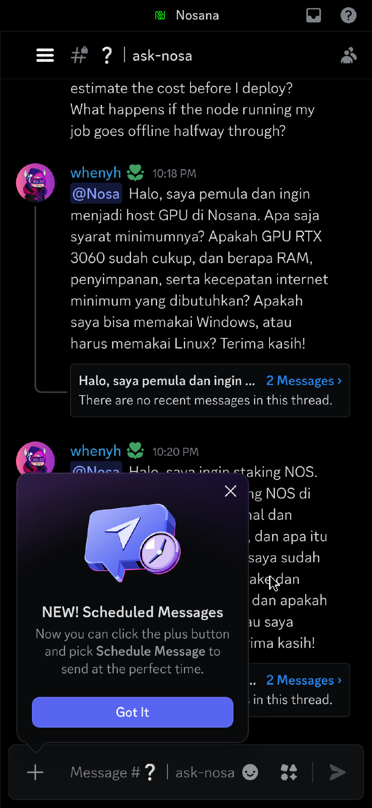
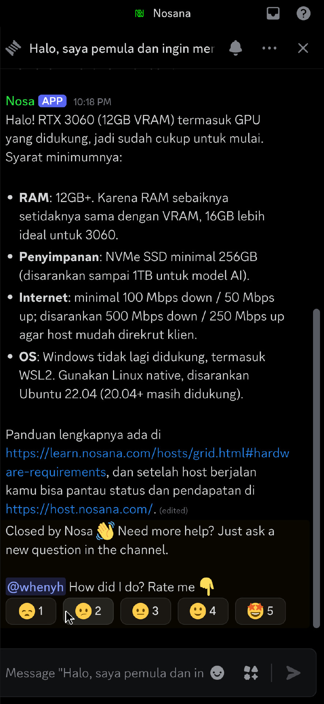
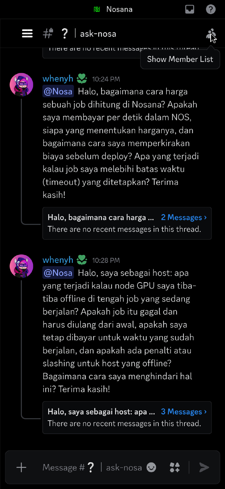
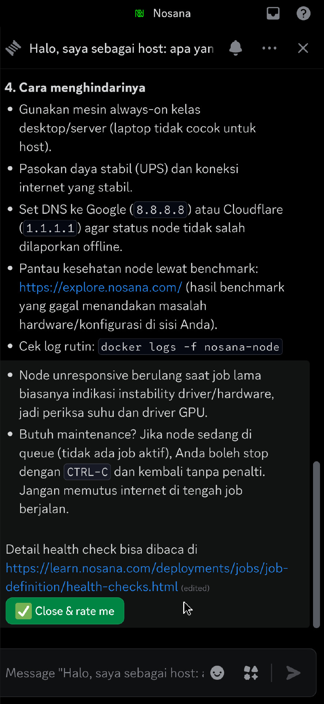
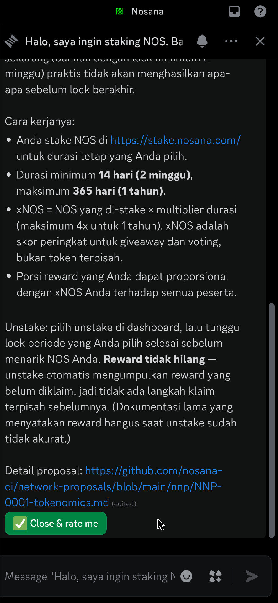

# Nosa Feedback — Superteam Earn Bounty Submission

**Bounty:** Provide Feedback on our new Support Assistant Nosa (Nosana)
**Participant:** Superteam Earn user `yaelahgil`
**Discord username:** `0xloe` (display name: whenyh)
**Server:** Nosana — channel **❔│ask-nosa**
**Date:** 17 November 2026

## How the feedback was done

Each question was asked one at a time in #ask-nosa with an @Nosa mention, in
Indonesian (as a genuine beginner / prospective host would ask). Each of Nosa's
answers was rated 1–5 via the "✅ Close & rate me" button, with detailed
written feedback submitted through the "Glad it helped" modal. Nosa confirmed
every rating with a "Thanks for the X ⭐" reply.

Note: written feedback submitted through the rating modal does not appear as a
public message in the thread, so the full text of each submitted feedback is
quoted below, next to its thread link and screenshots.

Four conversations were completed and rated (Q1 5/5, Q2 4/5, Q3 4/5, Q4 5/5).
The three best — Q1, Q4 and Q2 — are presented here.

---

## 1. GPU host minimum requirements — rated 5/5 ⭐⭐⭐⭐⭐

**Thread:** https://discord.com/channels/236263424676331521/1572187860445167646/threads/1572269705056751649

**Question (asked 22:18 WIB):** I'm a beginner and want to become a GPU host
on Nosana. What are the minimum requirements? Is an RTX 3060 enough, and how
much RAM, storage and internet speed do I need at minimum? Can I use Windows,
or must I use Linux?

**Nosa's answer (summary):** RTX 3060 (12GB VRAM) is supported and enough to
start; RAM 12GB+ (16GB ideal); NVMe SSD minimum 256GB (up to 1TB for AI
models); internet minimum 100 Mbps down / 50 Mbps up (500/250 recommended);
Windows including WSL2 is no longer supported — Linux native required, Ubuntu
22.04 recommended (20.04+ still supported). Included links to the host
hardware-requirements docs and host.nosana.com.

**Written feedback submitted with the 5/5 rating:**

> Jawaban sangat akurat dan lengkap sesuai dokumentasi, rapi, berbahasa
> Indonesia, dan menyertakan tautan dokumen. Yang masih kurang: syarat ping di
> bawah 100 ms dan aturan satu GPU per PC tidak disebutkan, serta RTX 3060
> juga ada varian 8GB VRAM sehingga sebaiknya disebut varian 12GB yang
> dimaksud.

**Screenshots:**

---

## 2. Host node goes offline mid-job — rated 5/5 ⭐⭐⭐⭐⭐

**Thread:** https://discord.com/channels/236263424676331521/1572187860445167646/threads/1572272176411709602

**Question (asked 22:28 WIB):** As a host, what happens if my GPU node
suddenly goes offline in the middle of a running job? Does the job fail and
have to restart from scratch? Do I still get paid for the time already run?
Is there any penalty or slashing for an offline host? How can I avoid this?

**Nosa's answer (summary):** An offline host ends the client's workload —
there is no automatic checkpoint/resume. Payment is guaranteed only for
completed jobs, so an unfinished job is not paid. There is no documented
on-chain slashing mechanism; instead there is a reliability/availability
rating — repeated disruption lowers the rating, a Premium market can drop to
Community with lower job rates, and manually cancelling a client job risks
demotion or removal from the network, while 2–3 hours of downtime was said
not to be significant. Prevention tips: always-on desktop/server-class
machine (laptops unsuitable), UPS and stable internet, Google (8.8.8.8) or
Cloudflare (1.1.1.1) DNS, monitor benchmarks at explore.nosana.com,
`docker logs -f nosana-node`, and stop with CTRL-C only while the node is in
queue (no active job). Linked the job health-checks docs.

**Written feedback submitted with the 5/5 rating:**

> Ini jawaban terbaik dari empat pertanyaan — jujur membedakan hal yang
> terdokumentasi dan yang tidak, konsekuensi rating sangat konkret, dan
> tipsnya spesifik serta bisa langsung dipraktikkan. Yang masih kurang: aturan
> "pembayaran hanya untuk job yang selesai" tidak disertai tautan ke halaman
> dokumen yang menyatakannya, ambang downtime 2–3 jam tidak disertai sumber,
> dan jawaban terpotong menjadi dua pesan sehingga poin 1–2 agak sulit dibaca
> utuh.

**Screenshots:**

---

## 3. Staking, unstaking and xNOS — rated 4/5 ⭐⭐⭐⭐

**Thread:** https://discord.com/channels/236263424676331521/1572187860445167646/threads/1572270329030643836

**Question (asked 22:20 WIB):** I want to stake NOS. How does staking work,
what are the minimum and maximum durations, what is xNOS, how do I unstake
and withdraw NOS after the lock ends, and can rewards be lost if I unstake
before claiming?

**Nosa's answer (summary):** Important warning that staking is being wound
down under NNP-0001 — the reward pool is capped at 720,000 NOS and exhausted
after 28 November 2026, so staking now practically earns nothing before the
2-week minimum lock ends. Stake at stake.nosana.com, duration 14–365 days,
xNOS = staked NOS × duration multiplier (maximum 4x for 1 year); xNOS is a
ranking score for giveaways and voting, not a separate token; reward share is
proportional to xNOS. Unstake via the dashboard, then wait for the lock to
end before withdrawing NOS. Nosa stated "rewards are not lost — unstaking
automatically collects unclaimed rewards" and that the old documentation is
no longer accurate, linking the NNP-0001 proposal on GitHub.

**Written feedback submitted with the 4/5 rating:**

> Angka-angka inti benar dan peringatan NNP-0001 sangat berharga karena tidak
> ada di halaman staking yang saya baca. Tetapi klaim soal reward bertentangan
> langsung dengan halaman Rewards yang masih terbit ("You MUST claim your
> rewards before unstaking, or they will be voided!") tanpa mengutip pasal
> NNP-0001 yang mengubah aturan itu, sehingga pemula akan bingung. Jawaban
> juga tidak menjelaskan unstake sebelum lock berakhir dan tidak menyebut
> langkah Close/Withdraw. Saran saya: perbaiki halaman Rewards agar konsisten
> dengan NNP-0001.

**Screenshots:**

---

## Why these three

- **Q1 (5/5):** the cleanest complete answer — accurate, well-structured,
  fully sourced — with two concrete, checkable gaps (ping rule, one-GPU rule,
  3060 8GB variant).
- **Q4 (5/5):** the most useful answer of the four — honest about what is and
  isn't documented, concrete rating consequences, immediately actionable
  prevention steps.
- **Q2 (4/5):** the most valuable single finding — Nosa's reward claim
  directly contradicts a still-published docs page, a real inconsistency a
  beginner would trip over, with a concrete fix (align the Rewards page with
  NNP-0001).

A fourth conversation (job pricing and timeouts, rated 4/5) was also
completed; it is not included here because the bounty asks for up to three.
